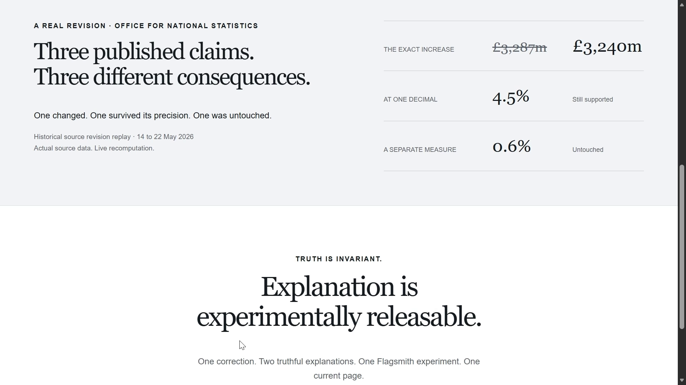
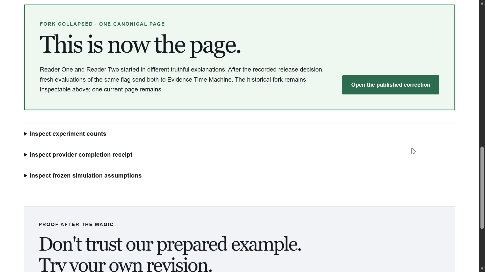
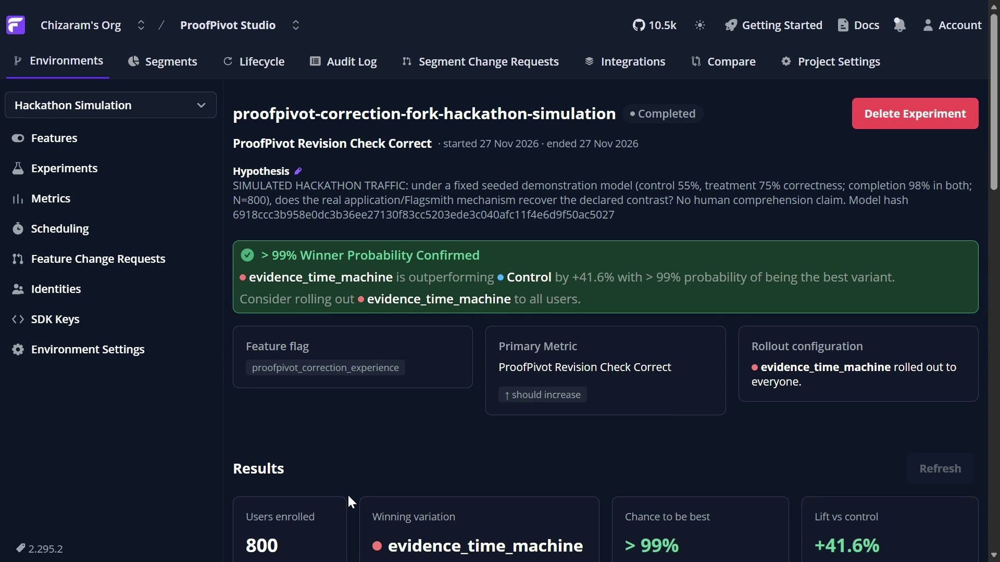
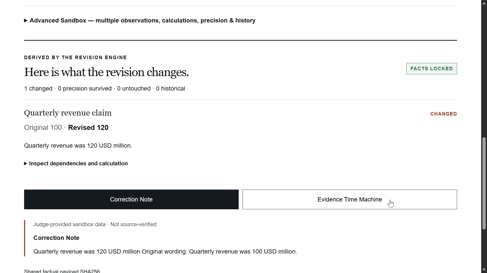

# ProofPivot — Correction Fork

**Same facts. Two explanations. One earns the page.**

ProofPivot is a correction-publishing system for a difficult editorial problem: when an official source changes after publication, **some claims must change, some remain publishable only because their displayed precision still holds, and some were never affected at all**.

ProofPivot recomputes every claim from one truth-locked factual payload, lets only the **explanation** vary behind a real Flagsmith multivariate flag, measures the two explanation worlds through Flagsmith Experimentation, and then uses that **same flag** to collapse the fork into one canonical published correction.

Built for **Toggle Wars 2026 — Track 01: Test Something Real**.

> **Reviewer boundary:** Experiment 912 used real Flagsmith assignment, exposure, metric-event and rollout machinery with **800 explicitly simulated hackathon sessions**. The simulation demonstrates the real product/experiment mechanism under assumptions frozen before traffic. It does **not** establish that real humans understand one explanation better.



**Start here:** [Live product](https://proofpivot-correction-fork.ochresnow128.chatgpt.site) · [Current correction](https://proofpivot-correction-fork.ochresnow128.chatgpt.site/correction) · [Experiment + Fork Collapse](https://proofpivot-correction-fork.ochresnow128.chatgpt.site/judge) · [Sandbox](https://proofpivot-correction-fork.ochresnow128.chatgpt.site/sandbox) · [Final demo](https://youtu.be/h94xE5Ju1No)

**Evidence:** [Completed experiment receipt](proofpivot/receipts/hackathon-simulation-result.json) · [Frozen simulation contract](proofpivot/simulation-freeze.json) · [Current source tree](.) · [Toggle Wars rules](https://www.wemakedevs.org/hackathons/flagsmith/rules)

---

## The important part in 30 seconds

ProofPivot starts with a real historical correction from the UK Office for National Statistics.

The original 14 May 2026 release and corrected 22 May 2026 release changed the underlying published Table 3 values. That produces **three different editorial consequences**:

| Published claim | Original source | Corrected source | ProofPivot state |
| --- | ---: | ---: | --- |
| Q1→Q2 2025 increase in corporations' gross operating surplus | **£3,287m** | **£3,240m** | **CHANGED** |
| Q1 2026 annual comparison, published to one decimal place | **4.5%** | **4.5%** | **SURVIVED PRECISION** |
| Separate real-GDP quarterly headline | **0.6%** | **0.6%** | **UNTOUCHED** |

The middle row is the important one.

The underlying exact calculation changes after the source correction, but both values still round to **4.5% at the article's declared precision**. ProofPivot therefore does not flatten the world into “changed” versus “unchanged.” It preserves derivation, source vintage and precision so the publication can distinguish:

**the number changed**,<br>
**the support changed but the published precision survives**, and<br>
**the claim was never touched by the correction**.

That is the product primitive underneath everything else.

---

## One truth, two explanation worlds

ProofPivot separates two things that are easy to accidentally mix during experimentation:

**what is true** and **how the correction is explained**.

The factual payload is constructed once by the deterministic revision engine. Both experiment arms receive that same object and the same payload hash. The flag is allowed to select only the renderer.

| Layer | Allowed to vary? | What ProofPivot does |
| --- | --- | --- |
| Source observations | **No** | Original/corrected source captures are fixed and hashed. |
| Derived claim states | **No** | The same deterministic engine computes changed / precision-preserving / untouched. |
| Answer key and scoring | **No** | The correct editorial action comes from the claim states. |
| Explanation renderer | **Yes** | Flagsmith selects `correction_note` or `evidence_time_machine`. |
| Final release | **Human-authorized** | A recorded release decision is applied through the same flag after provider result, guardrail and count-reconciliation review. |

The two explanation worlds are:

**Correction Note** — a conventional correction explanation.

**Evidence Time Machine** — a temporal explanation that lets the reader move between source vintages and watch the affected publication state follow the evidence.

The experiment asks which explanation wins **without ever giving the two arms different facts**.

---

## See the whole product in about a minute

| Step | Open / do | What should happen |
| --- | --- | --- |
| **1. See the correction problem** | [Home](https://proofpivot-correction-fork.ochresnow128.chatgpt.site) | The real ONS revision is summarized as **1 changed · 1 survived precision · 1 untouched**. |
| **2. Inspect what shipped** | [Correction](https://proofpivot-correction-fork.ochresnow128.chatgpt.site/correction) | The page identifies the current released explanation through a fresh evaluation of the same Flagsmith flag. |
| **3. Inspect the historical fork** | [Experiment](https://proofpivot-correction-fork.ochresnow128.chatgpt.site/judge) | Two actual recorded Experiment 912 identities show the historical **Correction Note** and **Evidence Time Machine** worlds with **FACTS LOCKED**. |
| **4. Ask what ships now** | Click **Verify what ships now** once | Both historical identities are freshly evaluated against the same flag. The historical replay creates no new experiment exposure, answer or conversion. |
| **5. Watch the consequence** | Keep the Experiment page open | The product resolves to **FORK COLLAPSED · ONE CANONICAL PAGE** and reveals **This is now the page.** |
| **6. Follow the release** | Click **Open the published correction** | You land on the actual canonical `/correction` page, not a separate status screen. |
| **7. Challenge the engine** | [Sandbox](https://proofpivot-correction-fork.ochresnow128.chatgpt.site/sandbox) | Quick Try can run a fresh revision such as **100 → 120** through the same generic revision engine with zero experiment traffic. |



The signature event is literal:

> **same facts → two truthful explanation worlds → recorded release decision → same flag → FORK COLLAPSED → one published page**

---

## Why Flagsmith is essential

Flagsmith is not a dashboard attached to ProofPivot. It is the control plane that makes the product theorem possible.

```text
                   ONE TRUTH-LOCKED PAYLOAD
                            │
             ┌──────────────┴──────────────┐
             │                             │
      Correction Note              Evidence Time Machine
             │                             │
             └──────────────┬──────────────┘
                            │
                Flagsmith multivariate flag
             proofpivot_correction_experience
                            │
             stable identity assignment
                            │
                exposure + metric events
                            │
                     Experiment 912
                            │
                recorded release decision
                            │
                SAME FLAG, rolled forward
                            │
               fresh identity evaluations
                            │
                    FORK COLLAPSED
                            │
                 ONE CANONICAL PAGE
```

Remove Flagsmith and ProofPivot loses the critical mechanism:

| Flagsmith responsibility | What breaks without it |
| --- | --- |
| Stable multivariate assignment | There are no trustworthy temporary reader worlds to compare. |
| Experiment membership and exposure accounting | The two explanations cannot be measured as one real experiment. |
| Metric events tied to the same identity | The experiment result no longer corresponds to the experience that reader saw. |
| Provider-side experiment result | There is no independent result to review and explain. |
| Rollout on the same feature | The winning explanation cannot become the released state through the mechanism that created the fork. |
| Fresh post-rollout evaluation | ProofPivot cannot prove that previously different readers now converge without a local renderer override. |

That last line is the core of the project.

ProofPivot does not merely use Flagsmith to **choose an arm**. It uses the same feature flag to turn an experiment result into a visible publication consequence.

---

## Experiment 912 — Test Something Real

**Experiment:** `proofpivot-correction-fork-hackathon-simulation`<br>
**Environment:** `Hackathon Simulation`<br>
**Feature:** `proofpivot_correction_experience`<br>
**Control:** `correction_note`<br>
**Treatment:** `evidence_time_machine`

The experiment question was intentionally narrow:

> Under a fixed, seeded simulation model frozen before traffic, can the real ProofPivot + Flagsmith assignment/event/result pipeline recover the declared contrast between the two explanation worlds without degrading completion?

The participant task was also narrow:

> **You are updating this article today. Which action is correct?**

The correct answer is derived from the truth-locked claim states:

**revise the Q1→Q2 increase, keep the one-decimal annual comparison, and leave the real-GDP headline alone.**

### Metrics

| Role | Flagsmith metric | Meaning |
| --- | --- | --- |
| **Primary** | `proofpivot_revision_check_correct` | The first submitted editorial action was correct. |
| **Guardrail** | `proofpivot_revision_check_submitted` | A first answer was submitted; the treatment should not materially reduce completion. |

The experiment uses **occurrence** aggregation. Exposure, submission and correctness are not inferred from page views; they are recorded through the normal product path.

### Fixed cohort result

| Actual provider/local count | Correction Note | Evidence Time Machine |
| --- | ---: | ---: |
| Assigned identities | **380** | **420** |
| Meaningful exposures | **380** | **420** |
| First answers submitted | **369** | **411** |
| Backend-scored correct | **207** | **324** |

**Provider result for the primary metric:**

**Relative lift:** **+41.61%**<br>
**95% relative-lift credible interval:** **+26.64% to +56.59%**<br>
**Provider win probability:** **99.999997%**

The interval is the important part: under the declared simulation model, it is entirely above zero.

The completion guardrail remained healthy. The treatment-control completion difference was about **+0.75 percentage points**, with a 95% interval of approximately **-1.44 to +2.95 percentage points**, above the predeclared -5-point harm margin.



> **Interpretation boundary:** these are **800 explicitly simulated hackathon sessions**, not 800 human readers. The result demonstrates the real assignment, event, inference and rollout mechanism under a frozen illustrative model. It does **not** establish that Evidence Time Machine improves real human comprehension.

<details>
<summary><strong>Inspect the frozen simulation contract</strong></summary>

The traffic model was frozen before the first event:

| Parameter | Frozen value |
| --- | --- |
| Sessions | Exactly **800** distinct indexed sessions |
| Seed | `20261127` |
| Correctness probability | `0.55` control / `0.75` treatment |
| Completion probability | `0.98` in both arms |
| Response window | **10 minutes** from first meaningful exposure |
| Meaningful exposure | First factual sentence at least 50% visible for 2,000 cumulative ms |
| Wrong answer | Uniformly selected among the three non-key choices |
| Stopping rule | Finish the fixed 800-session cohort; retry infrastructure failures at the same identity; never replace a session or alter the seed/probabilities for a preferred result |
| Analysis rule | Inspect only after fixed cohort + transport reconciliation; interval crossing zero = **INCONCLUSIVE**; integrity failure = **DO NOT ACT** |

Model SHA-256:

```text
6918ccc3b958e0dc3b36ee27130f83cc5203ede3c040afc11f4e6d9f50ac5027
```

Canonical files:

```text
proofpivot/simulation-freeze.json
scripts/simulate-hackathon.mjs
proofpivot/receipts/hackathon-simulation-result.json
```

</details>

<details>
<summary><strong>Inspect transport and integrity evidence</strong></summary>

The completed run records:

| Integrity check | Result |
| --- | --- |
| Successful indexed sessions | **800 / 800** |
| Terminal failures | **0** |
| Infrastructure retries | **1**, retried at the same indexed identity |
| Provider exclusions | **0** |
| Quarantined participants | **0** |
| Independent sample-ratio p-value | **0.1679** |
| Warehouse rows | **2,112 observed / 2,112 expected** |
| Distinct event names | **4** |
| Local/provider per-arm counts | **Reconciled** |

The 2,112 warehouse rows include the 2,111 logical experiment events plus one non-participant infrastructure canary.

Aggregate reconciliation is deliberately **not** represented as raw event-ID equality or an exactly-once delivery proof.

The archived receipt preserves two methodological limitations: the five-minute paired observation interval before completion was not evidenced, and a live provider partial-rejection/crash-after-acceptance drill was not executed. Later stable observations do not retroactively satisfy the earlier sequence. Historical build-review records are preserved in [docs/evidence/build-history/](docs/evidence/build-history/).

</details>

---

## The experiment result becomes the product

A result card alone would not complete the idea.

After the fixed cohort finished and provider/local counts reconciled, the user-authorized delegated editor decision selected **Evidence Time Machine**. Flagsmith completed Experiment **912** with:

```text
rollout_decision = variant
rollout_variant  = 36968  // evidence_time_machine
```

ProofPivot then re-evaluated two actual previously recorded experiment identities through the **same feature flag**:

| Historical reader | Before completion | Fresh post-rollout evaluation |
| --- | --- | --- |
| Reader One | `correction_note` / control / Experiment 912 | `evidence_time_machine` / no experiment membership |
| Reader Two | `evidence_time_machine` / treatment / Experiment 912 | `evidence_time_machine` / no experiment membership |

There is no local renderer switch in that convergence proof.

The experiment is history; the flag now represents the release.

That is why the Experiment page can truthfully say:

> **FORK COLLAPSED · ONE CANONICAL PAGE**<br>
> **This is now the page.**

### The canonical page fails closed

`/correction` does not hardcode Evidence Time Machine.

Its `/api/canonical` path:

1. reads the recorded completed simulation receipt;
2. verifies the expected run / experiment / feature;
3. performs a **fresh Flagsmith evaluation** for a stable canonical-page identity;
4. requires that current flag state to agree with the recorded release decision;
5. renders the existing tested explanation through the same truth-locked payload;
6. returns an error instead of inventing a page if those conditions do not agree.

Opening the public proof and canonical pages creates **zero new experiment exposures or conversions**.

---

## Evidence Time Machine

Evidence Time Machine is the selected explanation, not a second factual dataset.

The reader can move between the two source vintages and watch the publication follow the evidence:

**14 May · Original** → **22 May · Corrected**

The exact increase changes from **£3,287m** to **£3,240m**.

The annual comparison changes underneath, yet the published one-decimal sentence remains **4.5%**.

The separate **0.6%** GDP headline does not move.

That is the difference between a generic “before / after” UI and ProofPivot's revision model: the product knows **which claim changed, why it changed, what precision was promised, and which source vintage supports the current sentence**.

The two experiment arms still share the same factual payload hash.

---

## Don't trust the prepared example

The ONS correction is the witness, not the implementation.

The [Sandbox](https://proofpivot-correction-fork.ochresnow128.chatgpt.site/sandbox) runs fresh user-provided revisions through the same generic engine.

Quick Try begins with a deliberately boring example:

```text
Original value: 100
Revised value: 120
Sentence: Quarterly revenue was {value} USD million.
```

Run it and ProofPivot produces a new **CHANGED** claim. Switch the Evidence Time Machine between Draft and Corrected state and the sentence rewinds **100 ↔ 120**.



The Sandbox is deliberately isolated from experimentation:

| Sandbox property | Boundary |
| --- | --- |
| Flagsmith exposure event | **None** |
| Conversion event | **None** |
| Study identity / cookie | **None** |
| Database persistence | **None** |
| External source verification | **None** — judge-provided data is labelled as such |
| Revision engine | **Same validated generic engine** used by the packaged fixtures |

Advanced Sandbox supports multiple observations, calculations, explicit precision and historical/current semantics. Inputs are validated; incompatible comparisons fail closed instead of producing a guessed revision.

---

## Run and verify

There are two different reproducibility questions, and ProofPivot keeps them separate.

### 1. Reproduce the deterministic implementation with zero secrets

**Requirements:** Git, Node.js **24+**, npm, and Chromium for the browser suite.

```bash
git clone https://github.com/chizzydev/ProofPivot-Studio.git
cd ProofPivot-Studio

npm ci --include=dev --include=optional
npm test
npm run build

npx playwright install chromium
npx playwright test
```

`npm test` exercises the deterministic domain/integrity layer, including exact arithmetic, ONS/BEA genericity, Truth Lock, first-answer immutability, exposure ordering, retry/restart behavior, result honesty, canonical-read gating, Sandbox generated cases, Production freeze, simulation identities/model, study gate and warehouse reconciliation.

The browser suite exercises the real request handler, local database transitions, cookies, public routes and UI against isolated provider fixtures. It does **not** need live Flagsmith credentials.

GitHub Actions runs the same critical path on Node 24:

```text
npm ci
npm test
npm run build
npx playwright install --with-deps chromium
npx playwright test
```

### 2. Verify the actual competition experiment and release

The live competition result is not recreated by committing private provider keys.

Use the public evidence instead:

```text
proofpivot/simulation-freeze.json
proofpivot/receipts/hackathon-simulation-result.json
proofpivot/sources/ons-original.*
proofpivot/sources/ons-corrected.*
```

Then inspect the live product:

**Experiment:**<br>
https://proofpivot-correction-fork.ochresnow128.chatgpt.site/judge

**Canonical correction:**<br>
https://proofpivot-correction-fork.ochresnow128.chatgpt.site/correction

**Sandbox:**<br>
https://proofpivot-correction-fork.ochresnow128.chatgpt.site/sandbox

A separately deployed provider-backed instance requires its own Flagsmith environments/keys, D1 binding and run configuration. Secret key **values must never be committed**.

Core runtime/configuration names include:

```text
FLAGSMITH_ENVIRONMENT_KEY
FLAGSMITH_JUDGE_ENVIRONMENT_KEY
FLAGSMITH_SIMULATION_ENVIRONMENT_KEY

PP_SESSION_SECRET
PP_SIMULATION_SESSION_SECRET
PP_OPERATOR_SECRET

PP_ENVIRONMENT
PP_RUN
PP_QA_RUN
PP_SIMULATION_RUN
PP_SIMULATION_REPLAY

PP_ENROLLMENT
PP_QA_ENROLLMENT
PP_SIMULATION_ENROLLMENT

DB
```

The public repository documents the implementation and frozen receipts; it intentionally does not publish live secret values.

---

## Architecture

```text
                         ┌──────────────────────────┐
                         │      Public surfaces     │
                         │                          │
                         │ Home / Correction /      │
                         │ Experiment / Sandbox     │
                         └────────────┬─────────────┘
                                      │
                                      ▼
                         ┌──────────────────────────┐
                         │ Cloudflare Worker handler│
                         │ routing + study gates    │
                         └───────┬─────────┬────────┘
                                 │         │
                  ┌──────────────┘         └───────────────┐
                  ▼                                        ▼
      ┌────────────────────────┐              ┌────────────────────────┐
      │ Deterministic revision │              │ Flagsmith provider      │
      │ engine + Truth Lock    │              │ assignment/events/      │
      │                        │              │ experiment/rollout      │
      └───────────┬────────────┘              └────────────┬───────────┘
                  │                                        │
                  ▼                                        ▼
      ┌────────────────────────┐              ┌────────────────────────┐
      │ Claim state / renderer │              │ D1 ledger + durable     │
      │ Correction Note / ETM  │              │ outbox/evidence receipt │
      └────────────────────────┘              └────────────────────────┘


      Sandbox branch:
      browser-local validated inputs → same revision engine → rendered result
      no experiment identity → no Flagsmith event → no study write
```

### Important source locations

| Area | Path |
| --- | --- |
| Generic revision construction/validation | `proofpivot/core/payload-core.mjs` |
| Canonical ONS fixture adapter | `proofpivot/core/ons-fixture.mjs` |
| Revision engine | `proofpivot/core/engine.mjs` |
| Truth Lock / experience selection | `proofpivot/core/payload.mjs` |
| Question / scoring / analysis contract | `proofpivot/core/protocol.mjs` |
| Flagsmith provider and event delivery | `proofpivot/core/provider.mjs` |
| Ledger / durable outbox | `proofpivot/core/async-ledger.mjs` |
| Result/canonical gating | `proofpivot/core/readout.mjs` |
| Generic Sandbox | `proofpivot/core/sandbox.mjs` |
| Simulation identity/model | `proofpivot/core/simulation-identity.mjs`, `proofpivot/core/simulation-model.mjs` |
| Public + API worker routes | `proofpivot/worker-handler.mjs` |
| Simulation / QA isolation | `proofpivot/auxiliary-router.mjs` |
| Frozen competition model | `proofpivot/simulation-freeze.json` |
| Completed result + Fork Collapse receipt | `proofpivot/receipts/hackathon-simulation-result.json` |

---

## Source provenance

The canonical witness uses archived source bytes from the UK Office for National Statistics.

| Source vintage | Public source | Repository capture |
| --- | --- | --- |
| 14 May 2026 original | [ONS previous release](https://www.ons.gov.uk/economy/grossdomesticproductgdp/bulletins/gdpfirstquarterlyestimateuk/januarytomarch2026/previous/v1) | `proofpivot/sources/ons-original.html` + `.json` |
| 22 May 2026 corrected | [ONS corrected release](https://www.ons.gov.uk/economy/grossdomesticproductgdp/bulletins/gdpfirstquarterlyestimateuk/januarytomarch2026) | `proofpivot/sources/ons-corrected.html` + `.json` |

The JSON metadata records retrieval timestamps, source spans and SHA-256 values for the captured HTML.

ProofPivot compares the same published Table 3 basis across the two releases. It does not turn this witness into a broader real/nominal economic interpretation.

---

## Trust boundaries and claims discipline

ProofPivot is intentionally strict about what the evidence can and cannot establish.

| Safe claim | Boundary |
| --- | --- |
| Experiment 912 used real Flagsmith assignment/events/result/rollout machinery. | **Yes.** |
| 800 indexed sessions were run through the real product path. | **Yes — explicitly simulated sessions.** |
| Evidence Time Machine was selected under the frozen simulation model. | **Yes.** |
| The provider's primary relative-lift interval was entirely above zero under that model. | **Yes.** |
| The same flag later made previously different recorded identities converge to ETM. | **Yes.** |
| The canonical page performs a fresh same-flag check and fails closed on disagreement. | **Yes.** |
| 800 human readers preferred ETM. | **No.** |
| ETM improves human comprehension by 41.61%. | **No.** |
| Flagsmith autonomously made the editorial decision. | **No.** A user-authorized delegated editor decision selected the variant after provider result, guardrail and count-reconciliation review. |
| Sandbox inputs are independently fact-checked. | **No.** They are judge-provided and explicitly labelled. |
| Aggregate transport reconciliation proves exactly-once event delivery. | **No.** |

The dormant Production human-study path remains separate from the competition simulation. Production experiment **907** is closed and unstarted in the frozen competition evidence and contributes no human-comprehension claim to this submission.

---

## Why this is not just a correction widget

A conventional correction component can display a before/after value.

ProofPivot is trying to solve a deeper release problem:

**When evidence changes, which published sentences actually need to move—and how can a team test the explanation without making truth itself experimental?**

The system therefore combines four boundaries that usually live separately:

**revision semantics** — changed / precision-preserving / untouched;<br>
**truth locking** — both explanation worlds consume the same factual payload;<br>
**experimentation** — Flagsmith assigns and measures the temporary worlds;<br>
**release convergence** — the same flag collapses the fork into one current artifact.

The final object is not an experiment dashboard.

It is a published page.

---

## Technology

ProofPivot is built around:

| Layer | Technology |
| --- | --- |
| Product/UI | TypeScript, React, Next.js/Vite/vinext project shell |
| Runtime | Cloudflare Worker-compatible server |
| Persistence | Cloudflare D1 / SQLite-compatible ledger |
| Experimentation | Flagsmith Node SDK + Flagsmith Experimentation |
| Validation | Deterministic ES modules, exact arithmetic and hashes |
| Automated browser proof | Playwright / Chromium |
| Domain verification | Node's built-in test runner |
| CI | GitHub Actions on Node 24 |

No LLM decides whether a factual claim changed, whether a response is correct, or which variant Flagsmith assigned.

---

## Competition note

ProofPivot was built for **Toggle Wars 2026**, primarily targeting **Track 01 — Test Something Real**.

The competition explicitly permits simulated users/traffic for Track 01. This repository therefore makes the simulation boundary prominent instead of presenting scripted traffic as human evidence.

The submitted story is deliberately narrow:

> **Lock the facts. Fork the explanation. Let evidence decide what ships.**

And the product consequence is literal:

> **Same facts. Two explanations. One earns the page.**
